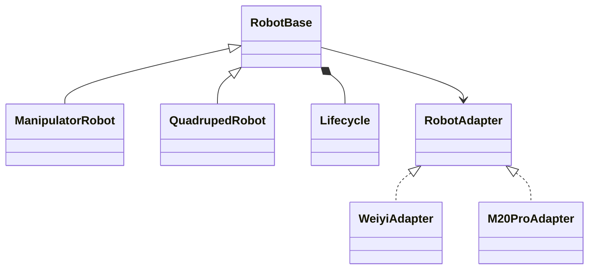

# Cross-Embodiment SDK v0.5 适配方案草稿

**日期：** 2026-10-21

**状态：** 讨论草稿；接口、目录和配置示例为拟议设计，尚未实施。

**设计基础：** [v0.4 正式设计](cross-embodiment-sdk-design-v0.4.md)、[v0.4 实施说明](../implementation/cross-embodiment-sdk-implementation-v0.4.md)。本文记录 v0.5 的增量设计，未替换的 Package、资产、Registry、Runtime 和安全边界继续沿用 v0.4。

## 1. 目标与范围

以 WY 机械臂与云深处山猫 M20 Pro 为两类参考硬件，解决当前 `Robot` 的共同职责与关节专用 API 混杂、统一动作链路尚不支持移动本体的问题。

本次讨论确定的方向：

1. 将当前 `Robot` 中的机械臂接口整理为 `ManipulatorRobot`。
2. 新增 `QuadrupedRobot`，作为四足机器人的类别抽象；M20 Pro 属于轮足本体，按该类别接入并显式声明轮相关能力。
3. 提取 `RobotBase` 共同抽象，使两类机器人继承相同的实例、生命周期、状态和动作调度行为。
4. SDK 维护通用类型、类别 API、校验与通信机制；硬件包维护厂商资产、具体协议和映射。
5. 先完成 M20 基础状态与归一化机身运动接入，不由遥操作接口推导底层关节控制、导航、完整全身控制或策略运行能力。

本文只提出适配方案，不代表已更新 SDK、硬件包或完成现场验证。

## 2. 与 v0.4 的关系

| v0.4 定义 | v0.5 拟议调整 |
| --- | --- |
| `Robot` 同时提供通用入口和关节便捷方法 | 共同实现进入 `RobotBase`；机械臂便捷方法进入 `ManipulatorRobot` |
| 能力优先，不依赖大型本体类型继承树 | 增加一层类别抽象；类别用于组织 API，实际能力仍由 Manifest、Adapter 和验证证据共同决定 |
| Base/Whole-body 协议尚未设计 | 先定义三轴归一化机身运动输入和基础移动状态；物理速度命令、全身控制分别设计 |
| 已有 ROS 2 Transport | 按本次接入需要补通用 UDP 数据报机制；厂商帧协议留在 M20 包 |
| `Robot.from_instance()` 返回通用句柄 | 迁移至 `RobotBase` 工厂及明确类别工厂，返回实际类别句柄 |

正式采用时需同步修订 v0.4 第 3.4、5、18、19、34、43 节对应内容及实施清单。正式 v0.4 文档在草稿阶段保留其历史基线，不在其中悄悄改写已确定的行为。

## 3. 类关系与职责



`RobotBase` 为共同抽象基类，提供共享的调度实现，不直接表示一种硬件型号。`ManipulatorRobot` 和 `QuadrupedRobot` 是面向应用的类别抽象，通过 Adapter 操作硬件。厂商包实现 `RobotAdapter` 契约，不需要再复制一套 `M20Robot` 或 `WeiyiRobot` 的应用侧句柄。

Python `ABC` 的具体抽象方法和类别工厂签名留待接口审查确定；不为使类无法实例化而引入没有业务意义的钩子。类别检查由 SDK 实现，不能要求厂商 Adapter 重复实现整个应用 API。

### 3.1 RobotBase 的共同职责

| 职责 | 拟议入口与行为 |
| --- | --- |
| 实例装配 | `from_instance()`：解析包、版本、后端、配置、授权和类别 |
| 初始化 | 构造内部调用 `Lifecycle.configure()`，完成静态配置；不公开 configure |
| 连接 | `connect()` 委托 Lifecycle；不隐式改变硬件模式或使能 |
| 生命周期 | 组合一个 Lifecycle，提供明确的 enable/disable/close 调度 |
| 状态 | `state()` 返回带时间、来源及有效性的统一状态 |
| 能力 | `capabilities()`、能力支持检查；不从类别名推断能力 |
| 动作 | `command(Action)` 执行通用校验、标准动作转换，再交给 Adapter |
| 资源 | 上下文管理、连接失败清理与资源关闭；close 不替代运动停止 |

共同基类不包含 `move_joints()`、步态切换或厂商端点。通用运动停止走已声明的 stop 动作链路，不能用停止进程、关闭 Socket 或取消请求模拟。

### 3.2 ManipulatorRobot

从当前 `Robot` 迁入 `get_joint_state()`、`move_joints()` 等机械臂便捷 API；末端接口按实际实现和能力逐项开放。各便捷方法只构造标准 Action，并复用共同校验与派发链路。

完整关节名称、单位、目标完整性和限位仍须验证。关节名称、厂商顺序、使能服务和控制器模式由硬件包解释。

关节能力本身并非机械臂独有。四足本体具备真实关节状态时也可以读取，但不能因设备有腿就开放关节目标控制。后续可将共用的关节 API 提取为能力组件，供多种类别组合使用。

### 3.3 QuadrupedRobot

提供四足/轮足本体的机身运动、机身状态与姿态/步态能力入口；首批只交付有标准语义且 Adapter 已实现的部分。

- 机身运动入口必须明确是归一化输入还是物理速度。
- `stand()` 表达本体站立状态转换，由 SDK 校验并交给 Hardware Package 映射；它不等同于 `connect()`、电机使能或标准运动输入状态。
- 其他姿态/步态切换需要独立的标准动作定义和转换前置条件；不把厂商模式整数作为 SDK 通用接口。
- 不强制实现站立、坐下、关节控制、导航等全部能力；不支持的操作明确拒绝。
- 类别检查不把 M20 的模式值、步态值或 UDP 参数放入 SDK。

### 3.4 复合本体

带机械臂的四足机器人同时具备移动与操作能力。v0.5 不采用 `M20WithArm(QuadrupedRobot, ManipulatorRobot)` 这样的多重继承作为默认装配机制。

共同的设备/能力描述和 Action 链路保留组合空间。类别 Facade 是便利入口，能力与设备才是实际控制目标；类别字段不能导致其他已验证能力被丢弃。复合本体的便捷 API 装配作为后续独立设计，不为本次两个参考案例建立深层继承树。

## 4. 实例创建与改名迁移

建议提供两种创建方式，以下均为设计示例：

```python
# 通用工厂按已验证的类别配置选择 SDK 内的 Facade。
robot = RobotBase.from_instance("lab/m20-pro-01", allow_motion=False)

# 应用知道所需类别时，显式检查，不匹配则在连接前失败。
arm = ManipulatorRobot.from_instance("lab/wy-right-arm-01", allow_motion=False)
quadruped = QuadrupedRobot.from_instance("lab/m20-pro-01", allow_motion=False)
```

类别选择由 SDK 管理的有限 Profile 和能力要求确定，不加载厂商自定义 Robot 子类。Manifest 中的 Profile 字段及 schema 版本需要在实施前冻结；不能靠包名或是否含 `joints` 猜测类别，也不能把草稿中的配置直接当作当前可解析格式。

按此前的完整重构要求，正式迁移时不保留旧 `Robot` 导入别名。更新 SDK 导出、实例工厂、CLI、示例、WY Demo 和相关检查；提供明确的升级说明。硬件包 Adapter 契约可以继续复用，不要求 WY 因句柄改名重写其厂商控制实现。

## 5. 通用动作与状态

### 5.1 归一化输入与物理速度分开定义

M20 手册的轴命令范围为 `[-1, 1]`，表示相对最大速度的输入比例。它不能直接实现以 m/s、rad/s 为单位的物理速度动作。

首批建议新增以下通用类型；名字是草稿建议：

| 类型 | 含义 | 单位 |
| --- | --- | --- |
| `BaseMotionInput` | x、y、yaw 三轴归一化机身运动输入 | dimensionless，每轴 `[-1, 1]` |
| `BaseState` | 实测线速度、角速度及机身姿态等可用观测 | m/s、rad/s、rad，逐字段声明 |
| `BaseTwist`（后续） | 给定物理线速度和角速度 | m/s、rad/s |

`BaseMotionInput` 的标准动作类型建议为 `base_motion_input`，dimension=3。输入比例相同不保证不同本体具有相同物理运动速度。

`BaseTwist` 只有在厂家给出可靠转换或经过独立验证时才能声明；不得猜测最大速度、用一次实测速度反推比例，或把归一化值改名为物理速度。

轴正方向、参考坐标系与机身前向必须在能力契约和包内映射中明确。M20 手册的 `Direction` 会影响正向定义；方向变化后不能继续沿用未经确认的坐标转换。

### 5.2 标准动作链路

```text
ManipulatorRobot / QuadrupedRobot 的便捷 API
    → Action + 明确的单位、坐标、目标与能力
    → RobotBase 通用授权、能力和状态检查
    → 动作类型对应的校验与 Runtime Action Mapping
    → 包内 Adapter 解释厂商语义
    → 通信机制
    → 硬件响应与实测反馈
```

当前 `ActionMapper` 仅实现关节和末端相关分支，必须补机身输入与 stop 动作的标准映射。`SafetyGuard` 的维度和范围处理目前依赖 positions/translation/rotation 等字段，需按标准动作结构扩展，不能让三轴输入跳过范围校验。

`RobotBase.command()` 不能继续硬编码关节目标检查；关节目标完整性归入对应动作的校验。公共授权、有限值、设备/能力检查与状态有效性保持统一。

### 5.3 状态与持续控制

统一状态扩展 BaseState 或设备观测承载方式，不将机身速度硬塞入关节位置字段。缺失或未验证的状态保持缺失，不补零。每类状态保留实际接收时间、来源和有效性。

状态新鲜度按动作所需数据判断，不能因为新的电池包到达就刷新旧运动反馈的有效期。对于持续运动，应用输入有效期、发送频率、状态失效处理与结果语义都必须明确；20 Hz 发送成功不等于硬件达到目标速度。

建议用具有有效期的持续运动输入，由明确拥有发送循环的一层执行。v0.5 基础方案可由应用以 20 Hz 提交输入，Adapter 负责心跳和接收线程；禁止 Adapter 在应用退出或输入过期后无限重发最后的非零输入。应用/通信失联的处理与硬件是否自动停机分别记录。

## 6. SDK、Adapter 与 Transport 的边界

| 位置 | v0.5 拟议改动 |
| --- | --- |
| `sdk/robot_base.py` | 共同句柄、初始化、连接、状态、能力和动作调度 |
| `sdk/manipulator.py` | 原 Robot 的机械臂 API |
| `sdk/quadruped.py` | 四足类别 API 与对应能力检查 |
| `sdk/lifecycle.py` | 复用通用调度，修正 v0.4 已记录的旧 stop 复合入口 |
| `protocol/` | 新动作/状态类型与明确的单位、坐标和有效期契约 |
| `runtime/mapping.py`、`safety.py` | 对应通用动作的转换与校验，移出 Robot 内的动作特判 |
| `runtime/installed.py` | Facade 选择、类别校验、返回类型与实例装配 |
| `transport/udp.py` | 通用数据报发送、接收、地址、接收时间、错误与资源清理 |
| `catalogs/`、`schemas/` | 新能力、Profile 和状态描述；同步发行包内资源 |
| M20 硬件包 | 二进制帧、JSON 字段、模式/步态/故障解释、心跳策略及动作确认 |

当前 `BackendTransport` 的 payload 为字典，不能直接宣称它已经支持任意 UDP 二进制帧。新增 UDP 机制需定义原始 bytes 的数据报契约；不为了复用 ROS 的请求结构而将 M20 编解码搬进 SDK。首版不要求将 UDP 放进现有 Transport Host；纯 Python 标准库后端可在明确资源所有权的应用侧运行。

UDP Transport 不知道 `PatrolDevice`、`MotionState`、M20 帧头或任何厂商成功码。SDK 不提供 M20 专用连接函数。

## 7. M20 Pro Hardware Package

建议独立目录 `ce-hardware-deeprobotics-lynx-m20-pro/`。包身份和版本在建包时确定，不把草稿名称作为已发布包引用。

```text
ce-hardware-deeprobotics-lynx-m20-pro/
├── package.yaml
├── embodiment.yaml
├── adapters/python/
│   ├── adapter.py          # RobotAdapter 实现与资源管理
│   ├── protocol.py         # 厂商帧、JSON 编解码和报文校验
│   ├── mapping.py          # 标准动作/状态与厂商语义转换
│   └── session.py          # 心跳、接收、关联与连接健康
├── config/                 # 默认连接与能力约束
├── vendor/                 # 获授权的原始材料及其使用说明
├── examples/               # 实例、状态读取和基础遥操作
├── tests/                  # 离线报文/契约检查与独立现场入口
├── validation/             # 版本、证据、结果和未验证项
├── provenance/             # 厂商资料、固件与报文依据
├── licenses/
└── README.md
```

有可分发的原始代码、接口库或手册时保留原始文件；受许可限制的材料记录版本、摘要、来源和获取方式，不假设 SDK 有权分发。该接口以网络协议交付，不要求虚构 ROS Driver、URDF 或厂商动态库。

首选 UDP Python 后端，TCP 作为后续可选后端。连接参数进入 Instance，不能在代码中写死本机地址。

## 8. 厂商手册依据与映射约束

主要依据：`Lynx-M20-Series-Software-Development-Manual-V0.0.4-0.pdf`，本机参考文件位于 `/home/robot/下载/`。下表页码为手册页脚页码；项目实施时补充文件 SHA-256、固件版本与具体证据索引。

| 手册依据 | 手册规定 | 适配安排 |
| --- | --- | --- |
| §1.1.2，第 5 页 | UDP `10.21.31.103:30000`；TCP `:30001` | Instance 中配置实际地址；UDP 首批实现 |
| §1.1.5，第 6—7 页 | 16 字节头；正文表为 `EB 91 EB 90`，含长度、消息 ID 等字段 | 包内 protocol 编解码和长度校验；附录帧头不一致处单独登记 |
| §1.2.1，第 9 页 | 心跳 Type=100、Command=100，建议至少 1 Hz；状态回传到心跳发送端 | 使用同一会话 Socket 收发；首版可配置 5 Hz 心跳 |
| §1.2.2，第 9—10 页 | `1101/5` 切换使用模式；Regular=0、Navigation=1 | 轴命令要求 Regular；模式切换是显式能力，不在 connect 中执行 |
| §1.2.3，第 10—11 页 | `2/22` 切换运动状态，含 Stand、Sit、Standard、Soft Emergency Stop 等 | 独立状态转换能力；不直接视为统一电机使能/下电 |
| §1.2.4，第 12—13 页 | `2/23` 切换步态，Basic=1、Stair=14 | 包内映射；未确认前不自动切换 |
| §1.2.5，第 13—14 页 | `2/21`；轴范围 `[-1,1]`；建议 20 Hz；Regular Mode；Basic/Stair 仅 X/Y/Yaw 有效 | 首版仅映射三轴输入；其余轴按该操作置零 |
| §1.3.1.1，第 16—18 页 | `1002/6` 基础状态 2 Hz；含 MotionState、Gait、HES、ControlUsageMode、Direction、Version | 分别映射安全、模式、方向与版本信息 |
| §1.3.1.2，第 18—20 页 | `1002/4` 运动状态 10 Hz；线速度 m/s、角速度 rad/s；腿关节角 rad、轮关节速度 rad/s | 机身状态、关节位置和轮速度分别建模，不输出 16 个“关节位置” |

### 8.1 手册与现有 Demo 的冲突

现有 `m20_keyboard.py` 使用 `MotionState=17`、`Gait=4097` 作为动作条件。手册列出 Standard=6，Basic=1、Stair=14。以手册作为适配依据，不能沿用 Demo 的常量，也不能擅自通过位掩码解释差异。

只读阶段记录实际报文、设备和固件版本。若实际值与手册不符，则对应状态保持 unknown，拒绝相关运动，取得适用手册/厂商说明后形成明确的版本映射。不能为了让 Demo 运行而放宽到“任何非急停状态均可运动”。

帧头按正文表作为初始依据；附录与正文的差异必须记录并以只读通信及适用资料确认，不实现静默兼容多个未知协议版本。

### 8.2 生命周期与运动允许条件

- configure：校验配置和静态资产，不创建硬件连接。
- connect：创建会话、启动心跳与接收，等待有效报文，核查设备版本；不自动站立、切步态或发送轴命令。
- enable/disable：手册中的模式/姿态命令不能直接等同电机使能/下电。没有确定映射时明确不支持，不以本地 armed 布尔量返回成功。
- 运动允许：结合授权、目标动作能力、有效且新鲜的状态、文档规定的控制模式/运动状态/步态、HES 和已知故障检查；具体厂商值在包内判断。
- close：释放线程和 Socket；不宣称机器人已停稳或下电。

通用 `requires_enable` 规则按硬件实际接口声明。不存在远程使能操作，不代表可以忽略外部使能和运动就绪条件；不能假报统一 enabled 来通过 SDK 校验。

### 8.3 停止与结果

归零轴输入表示请求零运动输入；UDP send 成功只证明本地派发。需要确认停止时，结合新鲜实测速度和事先确定的容差/持续时间判断；若缺少足够证据则结果未知。

软急停为独立厂商状态转换，不自动映射成日常 stop，更不替代硬急停。硬件自身的失联行为、保持最后输入的时长和停机保证尚需取得明确资料与现场证据。watchdog 能触发本地处理，但不能保证断网时命令送达。

## 9. 实施阶段与验收依据

| 阶段 | 交付与完成条件 |
| --- | --- |
| A：契约与迁移 | 冻结类别抽象、工厂/Profile、机身输入/状态和停止语义；列出旧 Robot 的调用迁移点 |
| B：SDK 基础 | 提取共同基类、迁入机械臂 API、新增四足 API；机身与站立动作走公共校验；WY 原能力与资源语义可继续使用 |
| C：包内离线实现 | 基于手册实现 UDP、协议、映射与会话；校验边界、错误包、丢包/乱序、状态失效和关闭行为，不连接硬件 |
| D：只读接入 | 明确授权后验证心跳、实际版本、字段、单位和频率；解决手册/固件差异，不改变运动模式 |
| E：基础运动 | 单独授权后，在已确认的允许状态中验证低速三轴、零输入、反馈及退出；姿态/步态切换逐项独立验证 |
| F：发布 | 更新 SDK/硬件包实际版本和摘要；安装到独立 Store，验证类别装配、能力清单和升级；记录已验证与未知项 |

验收覆盖两个参考本体，而非仅证明 M20 Demo 能运行。共有行为至少覆盖初始化无硬件副作用、类别不匹配、能力拒绝、控制授权、非法/越界输入、反馈失效、部分连接失败及清理。

新 Profile、Catalog、Schema 与发行包内资源须同步。完整测试失败、跳过和环境缺失如实记录；历史 WY 验收不自动成为新版本的现场验证。

## 10. 草稿待定项

### 当前代码状态（2026-10-21）

本草稿所述的基础类别分层和 M20 Pro 离线适配原型已落入源码，不能视为 v0.5 正式接口或现场验收结果：SDK 提供 `RobotBase`、`ManipulatorRobot`、`QuadrupedRobot`，Manifest 增加 Profile，四足类别可派发归一化三轴机身输入和通用 `stand()` 动作并读取基础状态，SDK 提供通用 UDP 数据报传输；独立 M20 Hardware Package 实现手册范围内的 UDP 帧、心跳、状态字段、受限的常规模式轴映射和显式站立状态切换。

本次离线验证结果为 SDK 测试 `246 passed, 8 skipped`，M20 Hardware Package 测试 `29 passed`。包默认阻止运动与站立转换；方向未知/反向、错误型号、未验证的运动状态转换和过期启动遥测均拒绝；没有启动厂商 Demo、连接真实机器人或验证实机行为。M20 包将 `live_hardware_tested: false` 标为 candidate；enable/disable、停止确认、步态切换、实机固件差异仍未完成。正式 v0.5 需先处理本节待定项并执行第 9 节 D–F 阶段。

以下事项影响正式接口，实施前需要明确：

1. `RobotBase`、`ManipulatorRobot`、`QuadrupedRobot` 的最终命名、Python ABC 边界，以及类别/Profile 的版本化方式。
2. 机身状态的统一承载结构、各字段新鲜度要求，以及坐标/前向变化的处理。
3. 归一化输入的有效期、循环所有者与停止确认标准；物理速度接口不纳入未验证承诺。
4. M20 实际固件与手册枚举/帧头差异的解释；取得依据前保留不支持或 unknown。
5. 姿态、步态、enable/disable 与 stop 的标准能力语义；不能由类名或厂商命令名称推定。

厂商具体能力以适用手册和版本证据为依据；SDK 共同契约以正式确认后的 v0.5 设计为依据。本草稿不把某次 Demo 的运行现象上升为跨本体标准。
