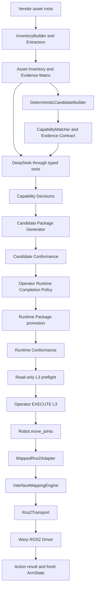

# Hardware Onboarding End-to-End Audit and Freeze

Date: 2026-10-16  
Branch: `feature/body-aware-robot-agent-mvp`  
Reference case: `weiyi-dual-o6-right-arm/v0.1`

## 1. Frozen conclusion

The Weiyi right-arm onboarding experiment reached L3 for exactly two
capabilities:

- `joint_position_state`
- `joint_position`

The generated package was built from isolated vendor assets, explicit platform
schemas, deterministic extraction and matching, a real DeepSeek semantic
review, and a separately confirmed Runtime Completion Policy. It was then
loaded by the fixed Unified Robot SDK and completed one real joint-6 probe and
return with measured arrival.

This result does not establish support for another vendor, a Python or native
backend, ROS2 services or publishers, streaming control, Cartesian control,
the left arm, or the hands.

## 2. Evidence ledger

### Gate D: model-assisted interface decision

| Item | Frozen evidence |
| --- | --- |
| Original full scan | 1,368 assets, 638 evidence records |
| Full scan evidence types | robot models 6; native binaries 87; native headers 204; Python modules 240; ROS2 endpoint candidates 14; arrival policy 1; action usage 8; subscription usage 12; launch definitions 13; ROS2 packages 12; interface definitions 32; joint configurations 9 |
| Reviewed real-model input | 8 assets, 18 evidence records |
| Platform revision captured at Gate D | `6fa287b988597245c00495d7ecec36ab31244499` |
| Provider | DeepSeek `deepseek-chat` |
| Provider transcript | 6 assistant turns, 16 native Tool Calls, 16 matching Tool Results |
| Tool distribution | `get_evidence` 13; `assess` 1; `accept_deterministic_candidate` 1; `record_conclusion` 1 |
| Transcript SHA-256 | `4855dfe2450f15e913fdc7b1b508224314c9c6dd86c818703f5938bdca564f2b` |
| Model decision | `joint_position_state=mapped`; `joint_position=gap` only for three execution-policy fields |
| Saved replay | interface mapping complete; candidate generated; policy unresolved; no motion |
| Candidate Conformance | 7 checks passed, no failures |

The final archived real run used a reviewed subset so the model did not need to
search 638 records blindly. The full scan remains archived and its replay
proves that the reviewed records came from the original asset set. This
curation was an engineering step, not a DeepSeek discovery.

The authoritative Gate D files are under:

```text
onboarding-evidence/weiyi-right-arm-20261015-gate-d/
```

`SHA256SUMS` verifies all 46 archived files.

### Gate E: policy, runtime package, and hardware

| Item | Frozen evidence |
| --- | --- |
| Candidate package digest | `2ca45703f74a3005a5d57cf5d8d23aca255cb2dadf3140e3064f92acbe0d846c` |
| Candidate mapping SHA-256 | `540b14e082d2b3a41883ca221d479636b14afcf52787980b20b43ed6b88cfb4b` |
| Runtime policy SHA-256 | `786ad9bf3f18691bd3670f25046f1ec1c7828a5ed09aec320a3a06ba99a0207e` |
| Policy source | `previously_live_validated_runtime_policy`; operator-confirmed; not vendor-declared |
| Policy values | timeout 90 s; arrival tolerance 0.015 rad; settle window 1.0 s |
| Runtime mapping SHA-256 | `f9bbd83f1c7de63869a912f0cf2bea08a140b0d5de14bc7b5eec4f569a3a7b17` |
| Generator package digest | `ab9eeeba9e81aed0ae295da003372300e05f3fd4efeda84dddf9fbfad94befaf` |
| L3 loader tree digest | `b917fd226eec6771605034ffe0f518df33fadb805c1aeec1b9ae2b12ef1161e2` |
| Runtime Conformance replay | 10 checks passed; no ROS connection; no motion |
| E4 | fresh seven-joint state, mode 104, fault code 0, `motion_sent=false` |
| E5 probe | succeeded; backend status 4; vendor code 0; arrival confirmed; maximum error 0.000203252424 rad |
| E5 return | succeeded; backend status 4; vendor code 0; arrival confirmed; maximum error 0.000142851961 rad |

The generator digest and L3 tree digest use different digest algorithms. Both
bind relative paths and content, but their byte construction differs. Their
different values do not indicate a changed package. The L3 record binds the
actual live run to the loader tree digest and runtime mapping digest printed
above. A future maintenance task may standardize the algorithms; this freeze
does not change them.

The authoritative Gate E files are under:

```text
onboarding-evidence/weiyi-right-arm-20261015-gate-e/
```

The package was not modified after hardware acceptance. Its generation-time
`live_execution_ready=false` remains immutable. The external L3 record is the
evidence that the specific package and environment passed.

## 3. Actual implementation chain



| Stage | Input | Implementation and tool | Output |
| --- | --- | --- | --- |
| CLI definition | paths, scope, identity, provider | `cli/__init__.py:314` `_build_parser`; `:457` `_onboard` | typed onboarding command |
| Isolation and inventory | vendor roots, denied roots | `onboarding/workflow.py:160` `inspect`; `inventory.py:60` `InventoryBuilder.build` | `asset-inventory.json`, isolation manifest, platform lock |
| Evidence extraction | inventory plus vendor files | `workflow.py:168`; `extractors/ros2.py:675`, Python, native, and robot-model extractors | `interface-evidence.yaml` with provenance |
| Evidence consistency | inventory and extracted records | `evidence.py:17` `EvidenceMatrix.build`; `evidence_contract.py:207` | indexed evidence governed by one field contract |
| Deterministic assembly | scope, catalog, evidence | `workflow.py:205`; `candidate_builder.py:92` | `deterministic-candidates.yaml` |
| Field validation | catalog, scope, candidates, evidence | `capability.py:121` `CapabilityMatcher.assess` | mapping completeness and policy completeness kept separate |
| Model reasoning | typed context and tools | `providers.py:137` `DeepSeekProvider`; `agent.py:169` `OnboardingAgent.run`; `agent.py:252` tool dispatcher | terminal decision for every scoped capability and transcript |
| Backend fit | capability coverage and backend registry | `backend_fit.py:68` `BackendFit.evaluate` | fits or plugin requirements |
| Candidate generation | mapping-complete coverage and fit | `workflow.py:250`; `generator.py:75` | non-executable candidate mapping and provenance |
| Candidate validation | candidate directory | `workflow.py:352`; `conformance.py:206` | seven static/replay checks and explicit policy gap |
| Policy confirmation | three values, source, operator, reference | `cli/__init__.py:458`; `workflow.py:274`; `runtime_policy.py:26` | separate policy document; vendor evidence unchanged |
| Runtime promotion | sealed candidate, policy, fixed backend descriptor | `generator.py:349` `promote_candidate` | loadable package, mapping, connection, asset digests |
| Runtime validation | generated runtime package | `conformance.py:107` | schema, load, state decode, goal encode, failure, timeout, arrival replay |
| L3 package loading | explicit package root and device | `onboarding/l3.py:91` `_load_generated_runtime` | manifest, mapping, backend; no registry fallback |
| Read-only preflight | loaded runtime | `l3.py:162` `preflight_generated_package` | fresh canonical `JointState`, hashes, no commands |
| Authorized round trip | explicit target and fresh state | `cli/__init__.py:482`; `l3.py:201` | probe and return `L3ExecutionRecord` |
| Unified API | canonical device and joint map | `sdk/robot.py:81` `Robot.move_joints`; `:97` `command` | canonical `Command` and `CommandResult` |
| Mapping | canonical command or transport event/result | `mapping/engine.py:202`, `:232`, `:260` | `TransportRequest`, canonical `JointState`, decoded vendor result |
| Adapter lifecycle | manifest, connection, mapping | `driver/ros2_mapped.py:21`; `:178` `send_command`; `:265` arrival check | terminal result plus measured-arrival result |
| ROS2 transport | subscription/action request | `driver/ros2_transport.py:39` `connect`; `:96` `execute` | ROS2 subscription events and action terminal status |

## 4. Responsibility split in this case

### DeepSeek independently judged

- Read 13 selected evidence records through typed `get_evidence` calls.
- Distinguished `arm_fault.fault_code` from the fault category field.
- Accepted the evidenced state candidate.
- Recognized that the action endpoint, type, goal fields, constants, result
  fields, unit, and order supported joint-position mapping.
- Refused to promote application defaults to vendor execution policy.
- Ended both scoped capabilities in explicit terminal states instead of
  inventing values.

DeepSeek did not scan files, write arbitrary files, run shell commands, choose
the L3 target, configure the runtime policy, or authorize motion.

### Deterministic tools completed

- File inventory, hashing, type extraction, provenance, and evidence IDs.
- Candidate field assembly where facts were structurally available.
- Evidence Contract enforcement and device/endpoint association checks.
- Backend-fit evaluation.
- Candidate/runtime package generation and digesting.
- Candidate and runtime Conformance.
- Explicit package loading, state decoding, goal encoding, result decoding,
  and measured-arrival calculation.

### Codex engineering work completed

- Repaired provider multi-tool state handling and saved-response replay.
- Aligned Scanner, Evidence, Matcher, and field-level provenance contracts.
- Separated interface mapping completeness from completion-policy readiness.
- Added candidate-to-runtime promotion without copying the old mapping.
- Added L3 explicit-package loading, preflight, authorization, evidence output,
  early `not_ready` rejection, and terminal-whitespace normalization.
- Curated the reviewed 8-asset/18-evidence subset from the full scan for the
  final model run.

These were platform implementation and experiment preparation steps. They are
not evidence that DeepSeek wrote the complete integration by itself.

### Operator explicitly provided or confirmed

- Vendor asset directory and allowed/denied workspace boundaries.
- Target device, two target capabilities, and canonical seven-joint order.
- Package identity and intended ROS2 runtime environment.
- Runtime Completion Policy values and their non-vendor source.
- Vendor Driver launch and separate right-arm `SetPower` lifecycle step.
- Physical workspace readiness, L3 target review, `EXECUTE L3`, and observed
  real motion.

## 5. Minimum input assets for another vendor

The minimum is capability-specific. For joint-state plus joint-position over
an already supported ROS2 subscription/action backend, provide:

1. A runnable or inspectable vendor runtime identifying the state endpoint and
   command endpoint.
2. Message/action definitions or equivalent authoritative type descriptions.
3. At least one real usage example or runtime graph capture proving endpoint,
   type, goal operation, result interpretation, and state-field use.
4. Device-scoped joint order, units, and limits from configuration or vendor
   documentation.
5. Lifecycle evidence: readiness, fault field/code, success result, timeout or
   cancellation behavior where available.
6. Runtime installation information: OS, CPU architecture, middleware/version,
   dependencies, launch procedure, permissions, and required binaries/libraries.
7. Platform-side `scope.yaml` and `package-identity.yaml` naming the canonical
   device, joints, target capabilities, and selected backend.
8. An operator-approved completion policy when the vendor does not define one.

URDF, mesh, MJCF, USD, and STEP are optional for these two capabilities. A
URDF becomes necessary when onboarding derived FK/IK or frame-based
capabilities. Model assets never substitute for a runnable command interface.

## 6. Vendor-specific leakage audit

### No runtime leakage found

Production code under `src/cross_embodiment`, onboarding schemas, mapping
schema, Evidence Contract, matcher, generator, Mapping Engine, and ROS2
Transport contain none of these Weiyi constants:

- `/wy_robot1/*`
- `arm_control_interface/*`
- `MoveJ`
- `dual_o6`
- `right_arm_joint_*`
- ready value `104`

Those values occur only in vendor evidence, generated/reference artifacts, and
tests/fixtures, which is the intended boundary.

### One catalog label remains vendor-named

`catalogs/capabilities/v0.1.yaml:94` and `:192` list
`weiyi_right_arm_v0` under `required_for_profiles`. The catalog loader preserves
this metadata, but the current matcher/generator does not use it to inject
endpoints, fields, joint counts, units, or constants. It therefore did not
leak an answer into this experiment. It is still a vendor-named profile in a
platform catalog and should eventually move to a reference-profile asset when
the catalog format is next revised. This freeze records the issue without
changing the validated platform.

## 7. Reuse for the next vendor

Directly reusable:

- Unified Robot API and canonical `Action`/`Command`/`CommandResult` types.
- Capability Catalog and Evidence Contract for the two current capabilities.
- Inventory, ROS2/Python/native/model extractors and provenance format.
- Matcher, deterministic candidate builder, typed DeepSeek tools, generator,
  Conformance runner, isolation checks, policy promotion, and L3 tooling.
- `ros2_mapped` when the next runtime exposes compatible ROS2 subscription and
  action lifecycle semantics.

Must be extracted again:

- Endpoints, interface types, field paths, control constants, result/error
  semantics, ready values, joint order, units, limits, runtime dependencies,
  launch procedure, and lifecycle behavior.
- Robot identity, canonical joint naming, desired capability scope, and any
  installation-specific configuration.
- Runtime Completion Policy and live evidence for that robot/environment.

A Backend plugin is required when the vendor mechanism cannot be represented
by a registered backend, including Python-only SDK calls, C/C++ ABI calls,
TCP/CAN/serial/shared-memory protocols, or currently unsupported ROS2
publisher/service/streaming lifecycles. A missing semantic fact must remain a
gap; adding a Backend does not justify guessing it.

## 8. Remaining human intervention

For another ROS2 subscription/action arm with complete assets, the current
workflow still needs people at five boundaries:

1. Select the device, canonical joint names, and desired capabilities.
2. Supply/approve the vendor asset boundary and runtime dependencies.
3. Resolve genuine semantic ambiguity and approve non-vendor runtime policy.
4. Start and enable the vendor runtime and diagnose environment faults.
5. Review the exact L3 target and authorize physical motion.

Everything between those boundaries can run deterministically or through the
typed model workflow. A new transport requires Backend engineering and adds a
separate implementation/review step.

## 9. What this experiment proves

Supported by evidence:

- SDK Core did not need a Weiyi-specific API change.
- A Hardware Package can carry vendor endpoint, field, ordering, unit, and
  result semantics outside SDK Core.
- A real LLM can review evidence and preserve unresolved policy rather than
  invent values.
- Deterministic tools can turn accepted evidence into an isolated candidate,
  then a separately policy-completed runtime package.
- Explicit package loading can prevent registry/cache fallback.
- The same Unified Robot API can control the real Weiyi right arm through the
  generated package and verify measured arrival.

Not yet proven:

- Generalization to a second vendor or a different transport family.
- Automatic Backend generation for Python, native, TCP, CAN, or serial APIs.
- Capabilities beyond joint state and absolute joint position.
- Fully autonomous onboarding without scope, policy, environment, and live
  operator decisions.
- Completeness of static extraction for arbitrary coding styles or binary-only
  documentation.
- Real-time, Cartesian, collision-aware, multi-device, or mobile-base control.

